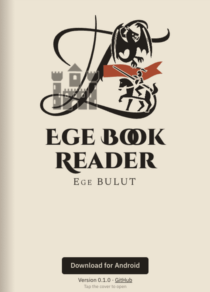
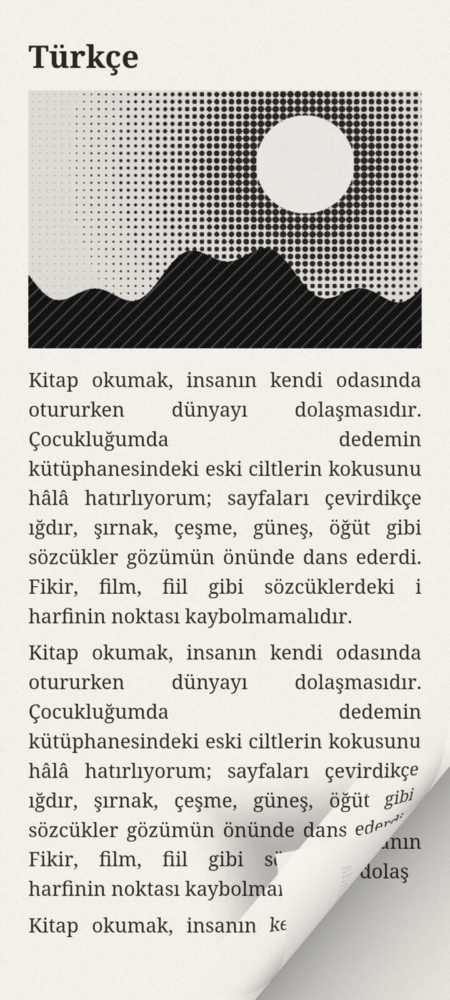
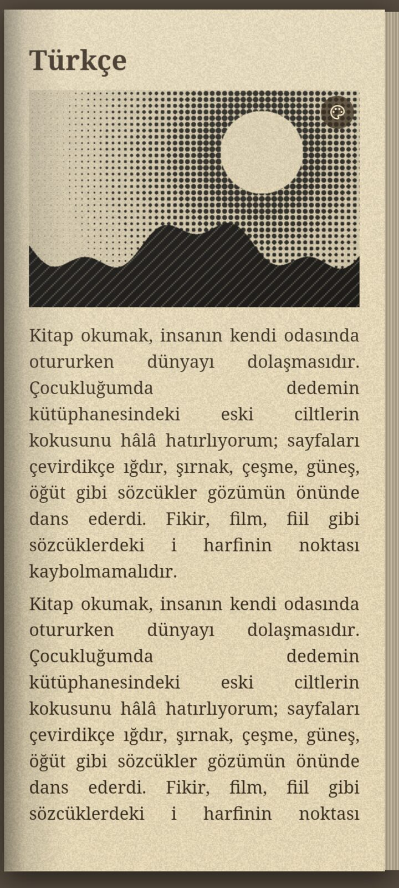
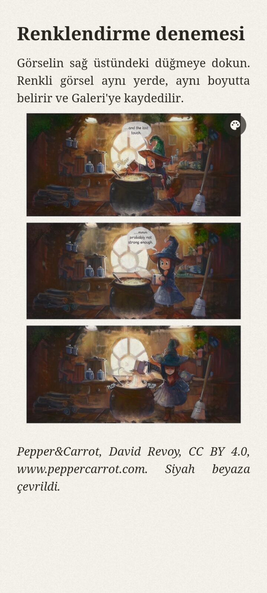
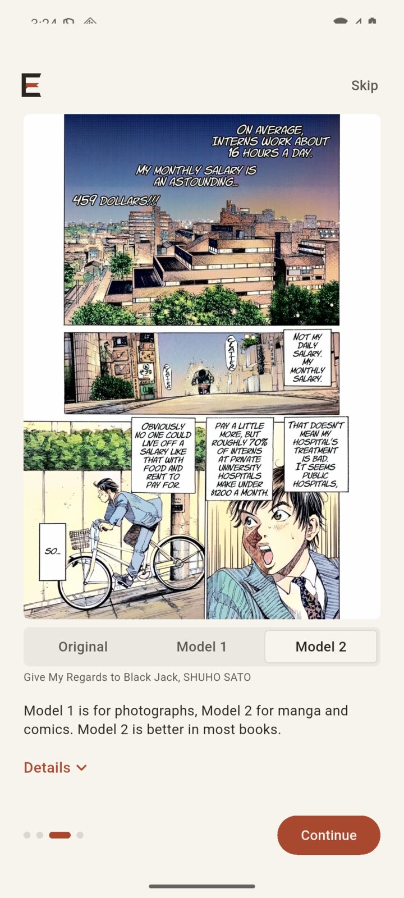
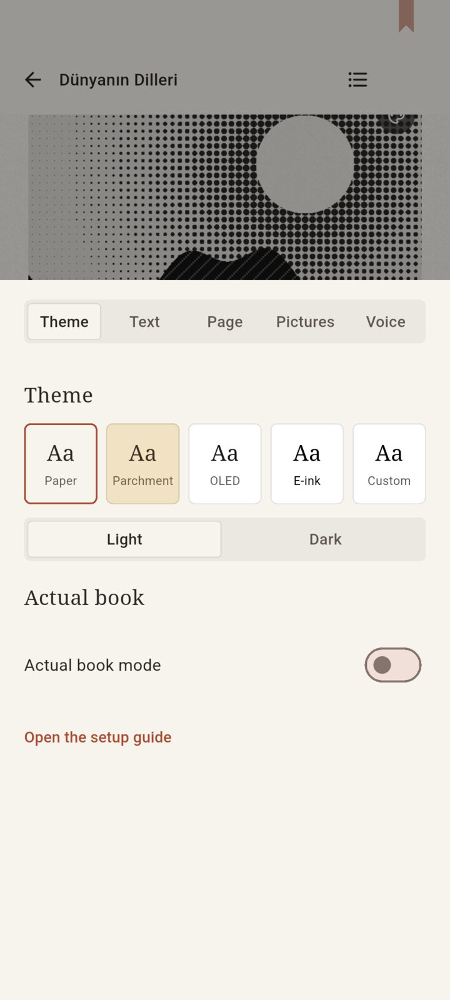
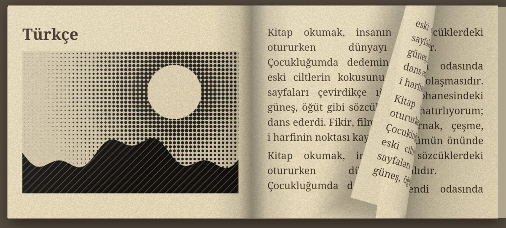
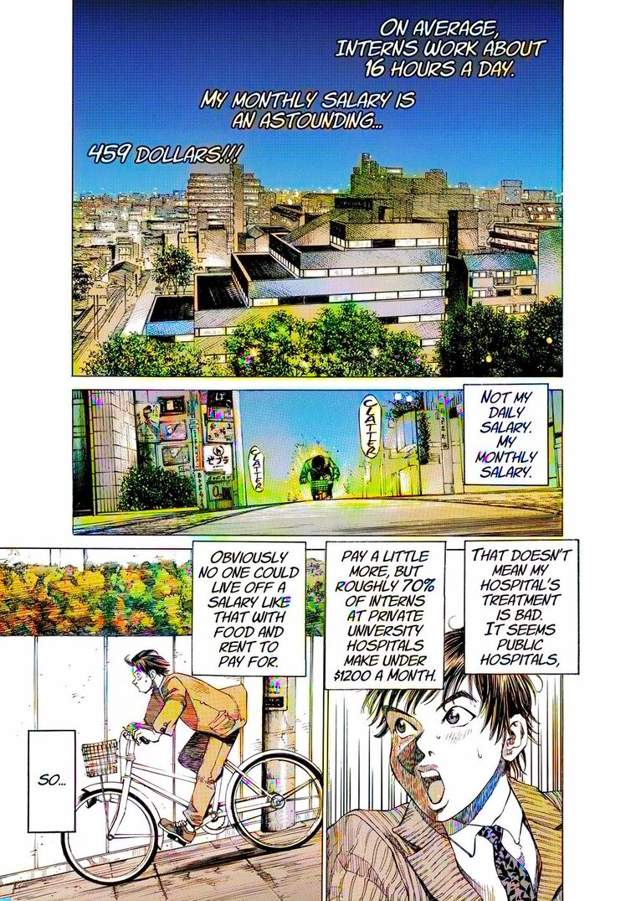
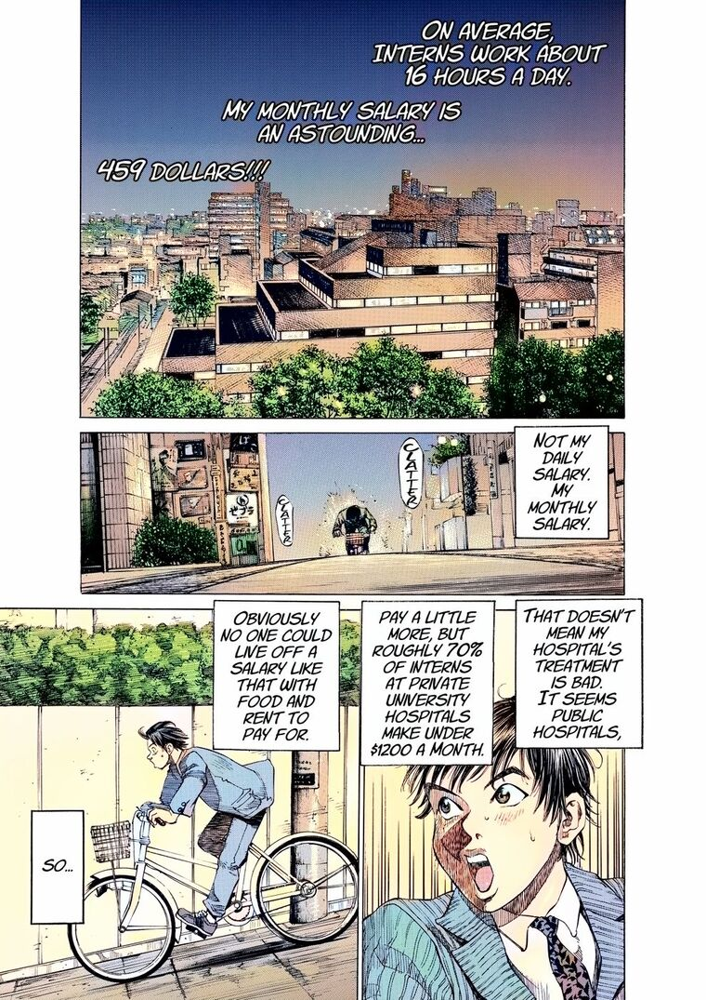
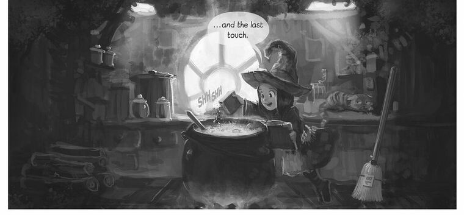

<div align="center">


<h1>EgeBookReader</h1>

<p><strong>An ebook and comic reader built around how reading feels.</strong><br>
Pages that really turn, an actual book mode, black-and-white manga coloured on your phone, and books read aloud.<br>
Free, open source, no account and no ads.</p>

<p>
  <a href="https://egebookreader.vercel.app/download/EgeBookReader.apk"></a>
  <a href="https://egebookreader.vercel.app"></a>
</p>

<p>
  
  
  
  
  <a href="LICENSE"></a>
</p>

<p>
  <a href="#why-egebookreader">Why</a> ·
  <a href="#gallery">Gallery</a> ·
  <a href="#features">Features</a> ·
  <a href="#install">Install</a> ·
  <a href="#build-from-source">Build</a> ·
  <a href="#known-limitations">Limitations</a> ·
  <a href="ROADMAP.md">Roadmap</a>
</p>



</div>

> [!NOTE]
> **0.1.7 is a preview for Android.** It has been tested on an emulator and by its author on one phone. iOS, Windows, macOS and Linux will come from the same code later.

## Why EgeBookReader

Most readers show you a document. This one tries to give you a book.

- **A page you can hold.** Take it by the corner, the edge or the middle. The curl follows your finger, in single-page and two-page layouts.
- **It looks printed.** Actual book mode adds paper grain, the shadow of the fold, lighting, the stack of pages at the sides and a shadow on the table.
- **Colour for black and white.** A small model on your phone colours manga and other pictures, offline. Only colour is added, so every line and letter stays where it was.
- **Listen when your eyes are tired.** Use the phone's voice, download a better one, or bring your own API key.
- **Nothing leaves your phone.** No account, no analytics. The internet is used only when you ask for a font, a model or a cloud voice.

## Gallery

<table>
  <tr>
    <td width="33%"></td>
    <td width="33%"></td>
    <td width="33%"></td>
  </tr>
  <tr>
    <td align="center"><sub>The page follows your finger</sub></td>
    <td align="center"><sub>Actual book mode</sub></td>
    <td align="center"><sub>Colorized on the phone</sub></td>
  </tr>
  <tr>
    <td></td>
    <td></td>
    <td></td>
  </tr>
  <tr>
    <td align="center"><sub>Setup compares the models</sub></td>
    <td align="center"><sub>Tap a picture to open it</sub></td>
    <td align="center"><sub>Settings over the live page</sub></td>
  </tr>
</table>

<p align="center">
  
  <br>
  <sub>Turn the phone and you get two pages, with the spine in the middle.</sub>
</p>

### Colorization examples

Done on the phone with the two downloadable models. Lines and lettering are untouched.

<table>
  <tr>
    <th width="33%">Original</th>
    <th width="33%">Model 1: DDColor</th>
    <th width="33%">Model 2: Manga Light Colorizer</th>
  </tr>
  <tr>
    <td></td>
    <td></td>
    <td></td>
  </tr>
  <tr>
    <td></td>
    <td></td>
    <td></td>
  </tr>
</table>

<sub><em>Give My Regards to Black Jack</em> by SHUHO SATO. Pepper&amp;Carrot by David Revoy, CC BY 4.0, converted to grayscale.</sub>

## Features

### Library

- **Favourites, your own lists, categories and tags.** A book can sit in several categories and lists. Long-press a book to change any of them, or to set your own cover picture (and go back to the original).
- **Sort and filter** from the bar above the shelf: by last read, date added, publication date (newest or oldest first), or title, author or publisher (A to Z or Z to A), or in sections by category. The filter sheet narrows by reading status, category, tag, format and language.
- **Book details** are read from the file when a book is added: title, author, publisher, date, language, ISBN, series, description and subjects, from EPUB, PDF, MOBI/AZW3, FB2, DOCX, ODT, HTML, Markdown, RTF and ComicInfo.xml in comics. A manga that says it reads right to left opens that way.
- **Find online** looks the book up on Open Library and suggests a category, tags and missing details. The search text starts as the title and author and can be edited, with a button to put it back. It runs by itself for new books unless switched off in Settings, Library; only the search text is sent.
- **Details** shows what the library, the file and Open Library each say, side by side. Tick the values to keep, edit any with the pencil, and save them into the book.
- **Gallery.** Every coloured picture in one place. Tap the page label under an open picture to jump to that page of its book.

### Turning pages

- **Flip** is the default. A cylinder curl drawn per pixel in a GPU shader, driven by where you grab the page. It settles with a spring and keeps the speed of your swipe.
- **Tap zones.** Draw rectangles and circles on the screen and give each one a job: previous, next, menu, bookmark. Portrait and landscape have separate layouts.
- **Right to left** for manga, set per book. The page lifts from the left edge, the left side of the screen turns forward, and two-page spreads read right to left.
- **Webtoons** scroll as one long strip: a comic whose pages are mostly taller than twice their width always scrolls, fitted to the width with no gap. In Scroll mode every comic and DjVu page keeps its own shape.
- **Endless vertical scroll**, with an adjustable gap between pages (2 px by default).
- **Volume keys** turn pages in every mode, and can be inverted.
- **Pinch to zoom.** Two fingers always zoom and one finger always turns, decided the moment the second finger lands. Zoomed pages are redrawn sharp.

### Formats

| Kind | Extensions |
|-|-|
| Books | EPUB, MOBI, AZW, AZW3, PRC, FB2, FBZ |
| Documents | PDF, DjVu, DOCX, ODT, RTF, HTML, XHTML, Markdown, TXT |
| Comics | CBZ, CBR, CB7, CBT |

DRM-protected books are not opened; the app says so. PDFs have a reflow switch, which pours the text into the reading layout.

### Themes and type

- **Paper, Parchment, OLED, E-ink and Custom**, each in light and dark. E-ink turns off every animation, gradient and texture.
- **Your own background:** a colour or a picture, with an overlay, brightness and blur. Text colour is measured against it and the background softens by itself until the text reaches 4.5:1 contrast.
- **About 2,100 free fonts** with live previews, filtered by style and script. Add your own from a file or a URL.
- **Flawless scripts.** Text is shaped with its language, so Turkish keeps the dot on its i, and Chinese, Hindi, Russian and Arabic set correctly.
- Dark PDFs recolour the type and leave photographs alone.

### Pictures

- **Filters** for saturation, contrast and sharpness, and a high-quality upscale. They apply to pictures only, never to text.
- **Sepia and tinted scans count as black and white.** The app looks at how many hue families a picture has, so only pictures that really have colour are left alone.
- **Colorize on demand** with the button on a picture. The same button then switches between colour and the original.
- **Colorize automatically:** the first pages when a book opens, the rest one by one in the background, resting between pictures and pausing when the phone is warm or saving battery.
- **Tap a picture** to open it over a dimmed page, zoom in and switch its colour.
- **Gallery** of everything coloured, with the book and page under each picture.

### Read aloud

- Each word is marked like a yellow highlighter as it is read, and the page turns by itself.
- Drag the bar on the player, or hold the marker and move it: the highlight follows live and the voice goes there.
- Speaking speed from 0.5x to 3x. Tap the speed button on the player to step through speeds, or hold it for a slider.
- Keeps reading with the screen off or another app in front, with pause and stop in the notification.
- The system voice is the default. Each downloadable voice lists its languages, license and source.
- Any service with an OpenAI-style `/audio/speech` endpoint works with your own key.

### Reading comfort

Library with covers and a continue-reading card, bookmarks on a ribbon, table of contents, a page scrubber, a screen that stays on while you read, and a first-run guide that lets you hear the voices and compare the colorizers. The interface is in English and Turkish.

## Downloadable models

Nothing here ships in the app. Each model comes from its authors' own release when you ask for it.

| Model | Purpose | Download | License | Source |
|-|-|-|-|-|
| Manga Light Colorizer | Manga and comics | 191 MB | CC BY-NC-SA 4.0 | [sharky172](https://huggingface.co/sharky172/manga-light-colorizer) |
| DDColor | Photographs | 206 MB | Apache-2.0 | [piddnad/DDColor](https://github.com/piddnad/DDColor) |
| Supertonic 3 | 10 voices, 31 languages including Turkish | 122 MB | MIT code, OpenRAIL-M model | [Supertone](https://github.com/supertone-oss-archive/supertonic) |
| Kokoro 1.1 | 103 voices, English and Chinese | 140 MB | Apache-2.0 | [hexgrad](https://huggingface.co/hexgrad/Kokoro-82M-v1.1-zh) |

Manga Light Colorizer's license forbids commercial use. EgeBookReader is free and will stay free.

## Install

1. Download the [APK](https://egebookreader.vercel.app/download/EgeBookReader.apk) on an arm64 Android phone.
2. Allow installs from your browser when Android asks.
3. Open the app. The setup takes a minute, and every step can be skipped.

Every version, with its notes, is also on [GitHub Releases](https://github.com/Ege-BULUT/EgeBookReader/releases). The app is not on Google Play yet.

## Build from source

You need [Flutter](https://flutter.dev) 3.47, the Android SDK with the NDK, and a JDK.

```sh
git clone https://github.com/Ege-BULUT/EgeBookReader
cd EgeBookReader/app
flutter test
flutter build apk --release --split-per-abi --target-platform android-arm64
```

The APK is written to `build/app/outputs/flutter-apk/`.

```
app/lib/        the app: reader, formats, colorizer, voices, setup
app/shaders/    page curl, dark PDF pages, picture filters
app/android/app/src/main/cpp/   native builds of libarchive, xz and DjVuLibre
site/           the website, plain HTML, CSS and JavaScript
memory/         requirements, research and the decisions behind the project
```

## Known limitations

- Android on arm64 only for now.
- DjVu pages are pictures only: no reading aloud, search or table of contents for them yet.
- PDF reflow leaves pictures out.
- Colours from any model are a guess: often good, sometimes wrong.
- A sentence that crosses two pages is read in two parts.
- Release builds are signed with a development key, so moving to a store build will need one reinstall.

## Contributing

[Report a bug](https://github.com/Ege-BULUT/EgeBookReader/issues/new?labels=bug) or [request a feature](https://github.com/Ege-BULUT/EgeBookReader/issues/new?labels=enhancement). A file that opens badly is the most useful bug report you can send.

## Credits

Sample pages from [Pepper&Carrot](https://www.peppercarrot.com) by David Revoy (CC BY 4.0) and *Give My Regards to Black Jack* by SHUHO SATO. Paper filters are inspired by [Okuma-Reader](https://github.com/DrMint/Okuma-Reader). PDF rendering by [PDFium](https://pdfium.googlesource.com/pdfium/) through [pdfrx](https://github.com/espresso3389/pdfrx), voices run on [sherpa-onnx](https://github.com/k2-fsa/sherpa-onnx), DjVu through [DjVuLibre](https://djvu.sourceforge.net) (GPL-2.0-or-later), CBR and CB7 through [libarchive](https://github.com/libarchive/libarchive) and [xz](https://github.com/tukaani-project/xz), fonts from [Fontsource](https://fontsource.org). The logo's E is from the Ruthie typeface (OFL), and the website's silhouettes are from [game-icons.net](https://game-icons.net) (CC BY 3.0).

## License

[GNU Affero General Public License v3.0](LICENSE). Made by [Ege BULUT](https://github.com/Ege-BULUT).
